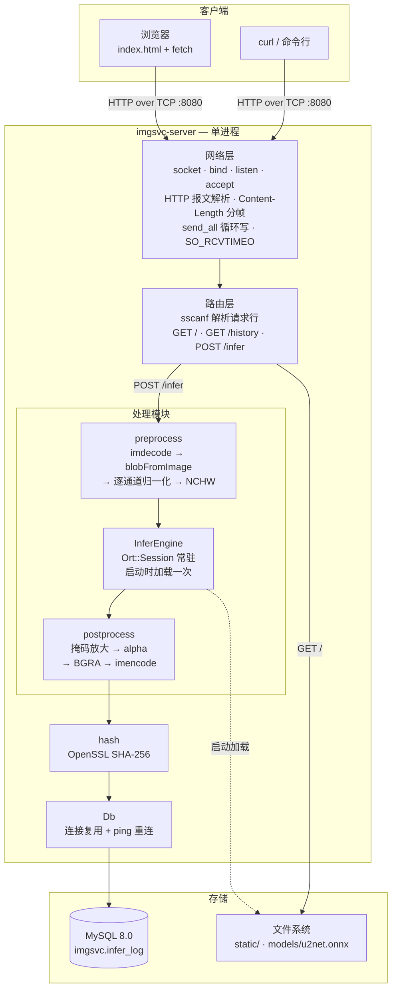
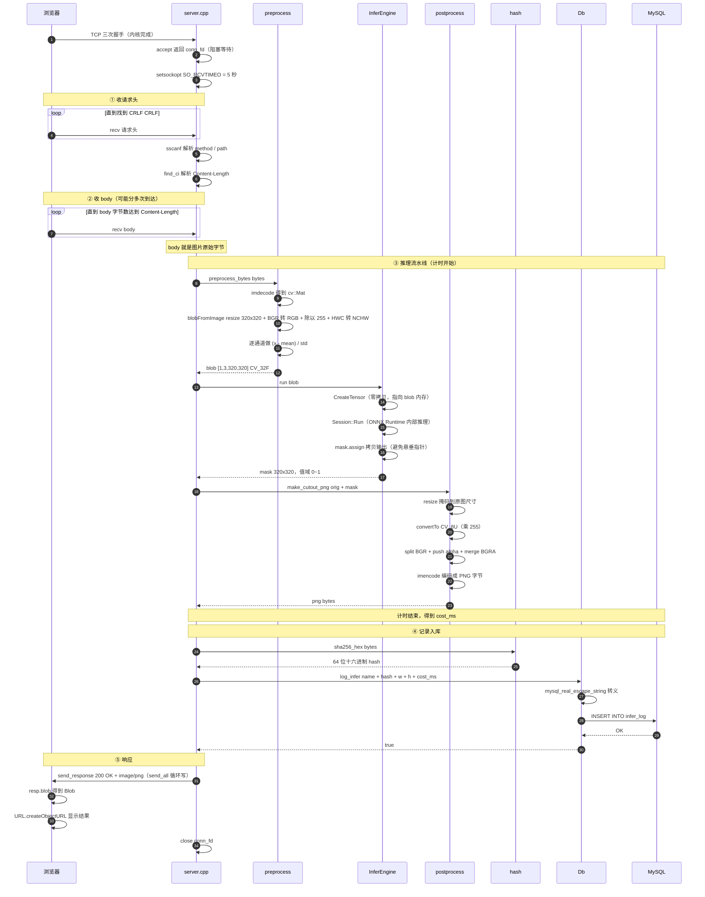
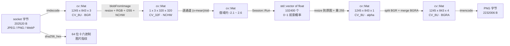
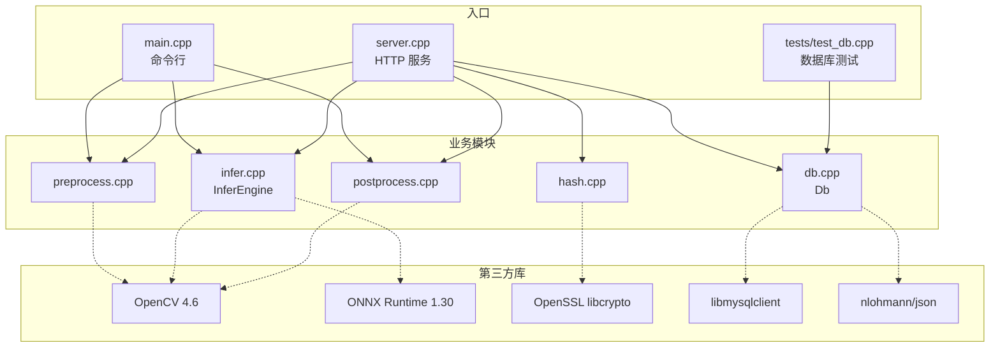
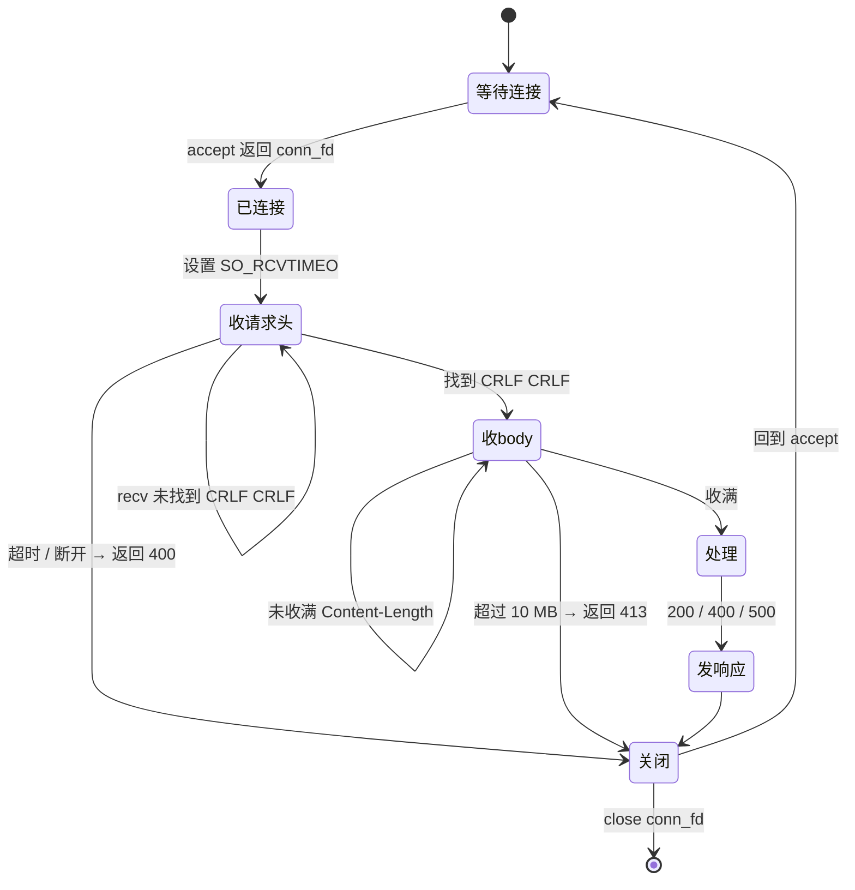
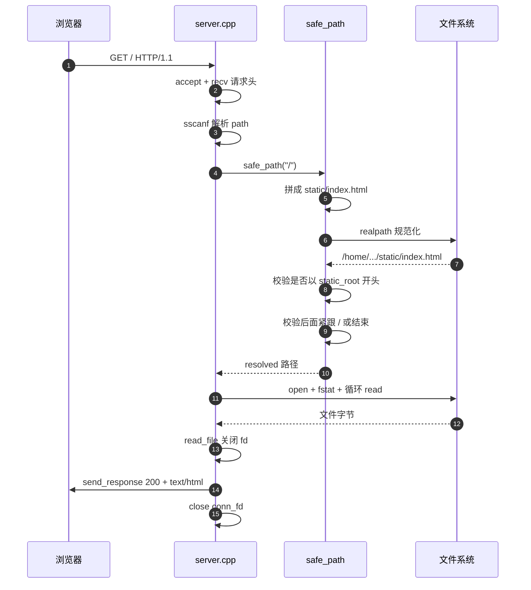

# imgsvc 架构图与请求时序图

> 本文档包含 Mermaid 图（GitHub / VSCode 可直接渲染）和 ASCII 图（终端 / 打印可用）。
> 对着 `docs/踩坑集.md` 一起看，效果最好。

---

# 一、系统架构

## 1.1 分层架构（Mermaid）



## 1.2 分层架构（ASCII）

```
┌─────────────────────────────────────────────────────────────────────┐
│ 客户端                                                               │
│   浏览器（index.html + fetch）              curl / 命令行              │
└──────────────────────────────┬──────────────────────────────────────┘
                               │ HTTP over TCP :8080
┌──────────────────────────────▼──────────────────────────────────────┐
│ imgsvc-server（单进程）                                               │
│                                                                     │
│  ┌───────────────────────────────────────────────────────────────┐  │
│  │ 网络层                                                         │  │
│  │   socket → bind → listen → accept                             │  │
│  │   循环 recv 收请求头（找 CRLF CRLF）                            │  │
│  │   解析 Content-Length → 循环 recv 收 body                      │  │
│  │   send_all 循环写（处理短写）                                    │  │
│  │   SO_RCVTIMEO 5s · MSG_NOSIGNAL                               │  │
│  └───────────────────────────┬───────────────────────────────────┘  │
│                              │                                      │
│  ┌───────────────────────────▼───────────────────────────────────┐  │
│  │ 路由层：sscanf 解析请求行                                       │  │
│  │   GET /          → 静态文件（realpath + 前缀校验）                │  │
│  │   GET /history   → Db::recent_json()                          │  │
│  │   POST /infer    → 推理流水线                                  │  │
│  └───────────────────────────┬───────────────────────────────────┘  │
│                              │                                      │
│  ┌───────────────────────────▼───────────────────────────────────┐  │
│  │ 处理模块                                                       │  │
│  │                                                               │  │
│  │   preprocess.cpp          infer.cpp            postprocess.cpp│  │
│  │   ┌──────────────┐    ┌────────────────┐   ┌───────────────┐  │  │
│  │   │ imdecode     │    │ InferEngine    │   │ 掩码→alpha     │  │  │
│  │   │ blobFromImage│──▶ │ Ort::Session   │──▶│ split/merge    │  │  │
│  │   │ 逐通道归一化   │    │ （常驻内存）     │   │ imencode      │  │  │
│  │   └──────────────┘    └────────────────┘   └───────────────┘  │  │
│  └───────────────────────────┬───────────────────────────────────┘  │
│                              │                                      │
│  ┌───────────────────────────▼───────────────────────────────────┐  │
│  │ hash.cpp（OpenSSL SHA-256） → db.cpp（连接复用 + ping 重连）     │  │
│  └───────────────────────────┬───────────────────────────────────┘  │
└──────────────────────────────┼──────────────────────────────────────┘
                               │
┌──────────────────────────────▼──────────────────────────────────────┐
│ 存储                                                                 │
│   MySQL 8.0（imgsvc.infer_log）      文件系统（static/ · models/）      │
└─────────────────────────────────────────────────────────────────────┘
```

---

# 二、POST /infer 请求时序

## 2.1 完整时序（Mermaid）



## 2.2 完整时序（ASCII）

```
浏览器          server.cpp            preprocess    InferEngine   postprocess    hash      Db      MySQL
   │                 │                     │             │            │           │        │         │
   ├── TCP 握手 ────▶│                     │             │            │           │        │         │
   │                 ├─ accept()           │             │            │           │        │         │
   │                 │  → conn_fd          │             │            │           │        │         │
   │                 ├─ SO_RCVTIMEO = 5s   │             │            │           │        │         │
   │                 │                     │             │            │           │        │         │
   │  ┌──── ① 收请求头（循环直到 CRLF CRLF）─────────────┐              │           │        │         │
   ├── recv ────────▶│                                  │              │           │        │         │
   │  └────────────────────────────────────────────────┘              │           │        │         │
   │                 ├─ sscanf 解析 method/path         │              │           │        │         │
   │                 ├─ 解析 Content-Length             │              │           │        │         │
   │                 │                     │             │            │           │        │         │
   │  ┌──── ② 收 body（循环直到收满）──────────────────┐              │           │        │         │
   ├── recv ────────▶│                                  │              │           │        │         │
   │  └────────────────────────────────────────────────┘              │           │        │         │
   │                 │                     │             │            │           │        │         │
   │                 │  ⏱ 计时开始         │             │            │           │        │         │
   │                 ├─ preprocess_bytes ─▶│             │            │           │        │         │
   │                 │                     ├─ imdecode   │            │           │        │         │
   │                 │                     ├─ blobFromImage（320×320）│           │        │         │
   │                 │                     ├─ 逐通道归一化 │            │           │        │         │
   │                 │◀───── blob ─────────┤             │            │           │        │         │
   │                 ├─ run(blob) ────────────────────▶ │            │           │        │         │
   │                 │                     │             ├─ CreateTensor（零拷贝）         │         │
   │                 │                     │             ├─ Session::Run              │         │
   │                 │                     │             ├─ mask.assign（拷贝）          │         │
   │                 │◀───── mask ──────────────────────┤            │           │        │         │
   │                 ├─ make_cutout_png ──────────────────────────▶ │           │        │         │
   │                 │                     │             │            ├─ resize 掩码         │         │
   │                 │                     │             │            ├─ 合并 BGRA          │         │
   │                 │                     │             │            ├─ imencode           │         │
   │                 │◀───── png ─────────────────────────────────────┤           │        │         │
   │                 │  ⏱ 计时结束 → cost_ms            │            │           │        │         │
   │                 │                     │             │            │           │        │         │
   │                 ├─ sha256_hex(bytes) ─────────────────────────────────────────▶│        │         │
   │                 │◀───── 64 位 hash ────────────────────────────────────────────┤        │         │
   │                 ├─ log_infer(name, hash, w, h, cost_ms) ────────────────────────────────▶│       │
   │                 │                     │             │            │           │        ├─ 转义 ─▶│
   │                 │                     │             │            │           │        ├─ INSERT▶│
   │                 │◀──────────────────────────────────────────────────────────────────── OK       │
   │                 │                     │             │            │           │        │         │
   │◀─ 200 + image/png ──────────────────┤             │            │           │        │         │
   ├─ createObjectURL 显示                │             │            │           │        │         │
   │                 ├─ close(conn_fd)     │             │            │           │        │         │
```

## 2.3 关键点标注

| 阶段 | 关键细节 | 对应坑 |
|---|---|---|
| ① 收请求头 | 必须**循环** recv 直到出现 `\r\n\r\n`，因为头也可能分多次到达 | 短读 |
| ② 收 body | **第一次 recv 可能已经把一部分 body 一起收进来了**，所以要算"已收到多少、还差多少" | 短读 + 边界计算 |
| ② 收 body | 上限 10 MB，超过返回 **413** | 内存耗尽攻击 |
| ③ 预处理 | `imdecode` 失败返回空 Mat（不抛异常） | C 风格错误 |
| ③ 推理 | `CreateTensor` **零拷贝**指向 blob，所以 blob 必须活到 `Run` 结束 | 悬垂指针 |
| ③ 推理 | `mask.assign` 必须**拷贝**，否则 `outputs` 析构后指针悬垂 | 悬垂指针 |
| ④ 入库 | 文件名来自客户端，**必须转义** | SQL 注入 |
| ⑤ 响应 | `send_all` **循环写**，大 PNG 一次发不完 | 短写 |
| ⑤ 响应 | `MSG_NOSIGNAL` 防止 SIGPIPE | 进程静默死亡 |

---

# 三、数据形状变换

## 3.1 数据流（Mermaid）



## 3.2 数据流（ASCII）

```
 ┌──────────────────┐
 │  socket 字节      │  202520 B（JPEG / PNG / WebP）
 └────────┬─────────┘
          │ imdecode
          ▼
 ┌──────────────────┐
 │  cv::Mat         │  1245 × 843 × 3，CV_8U，BGR
 └────────┬─────────┘
          │ blobFromImage：resize 320×320 + BGR→RGB + /255 + HWC→NCHW
          ▼
 ┌──────────────────┐
 │  blob            │  1 × 3 × 320 × 320，CV_32F
 └────────┬─────────┘
          │ 逐通道 (x - mean[c]) / std[c]
          ▼
 ┌──────────────────┐
 │  blob（归一化后） │  值域约 -2.118 ~ 2.640
 └────────┬─────────┘
          │ InferEngine::run
          ▼
 ┌──────────────────┐
 │  mask            │  std::vector<float>，102400 个，值域 0~1
 └────────┬─────────┘
          │ resize 回原图尺寸 + 乘 255 → CV_8U
          ▼
 ┌──────────────────┐
 │  mask8           │  1245 × 843 × 1，CV_8U（alpha 通道）
 └────────┬─────────┘
          │ split(BGR) + push_back(mask8) + merge
          ▼
 ┌──────────────────┐
 │  rgba            │  1245 × 843 × 4，CV_8U（BGRA）
 └────────┬─────────┘
          │ imencode(".png")
          ▼
 ┌──────────────────┐
 │  png 字节         │  2232006 B → 通过 socket 发回浏览器
 └──────────────────┘
```

**为什么每一步都要清楚形状？** 因为**任何一步的形状错了，都不会报错，只会出垃圾结果**。
实测校验方式：预处理后打印 `min/max`，理论值域 `[-2.118, 2.640]`，精确命中即正确。

---

# 四、模块依赖

## 4.1 依赖图（Mermaid）



## 4.2 一句话说明

> **`server.cpp` 完全不碰 `Ort::` 和 `cv::` 的底层对象，只调用 5 个函数：**
> `preprocess_bytes` / `engine.run` / `make_cutout_png` / `sha256_hex` / `db.log_infer`
>
> 换模型、换预处理、换后处理，网络层一行不用改。

---

# 五、构建产物

## 5.1 三个 target，共享模块

```
CMakeLists.txt
│
├── target: imgsvc                  （命令行工具）
│     src/main.cpp
│     src/preprocess.cpp            ┐
│     src/infer.cpp                 ├─ 共享模块 IMGSVC_MODULES
│     src/postprocess.cpp           ┘
│     链接：OpenCV · ONNX Runtime
│
├── target: imgsvc-server           （HTTP 服务）
│     src/server.cpp
│     src/db.cpp
│     src/hash.cpp
│     src/preprocess.cpp            ┐
│     src/infer.cpp                 ├─ 同一份源码
│     src/postprocess.cpp           ┘
│     链接：OpenCV · ONNX Runtime · libmysqlclient · libcrypto
│
└── target: test_db                 （数据库模块测试，不依赖模型）
      tests/test_db.cpp
      src/db.cpp
      链接：libmysqlclient
```

## 5.2 为什么要两个入口

| 用途 | 说明 |
|---|---|
| **调试** | 模块出问题时，不经过网络层直接复现，省掉 HTTP 干扰 |
| **交叉验证** | 同一张图，CLI 与 HTTP 输出 **SHA-256 完全一致** → 证明模块化重构没有改变行为 |
| **性能基准** | CLI 测纯计算耗时（不含网络），与服务器耗时相减可算出各层开销 |

---

# 六、连接生命周期

## 6.1 状态图（Mermaid）



## 6.2 ASCII

```
                        ┌──────────────┐
         ┌─────────────▶│  等待连接     │
         │              │  accept()    │
         │              └──────┬───────┘
         │                     │ conn_fd
         │                     ▼
         │              ┌──────────────┐
         │              │  收请求头     │◀──┐
         │              │  循环 recv    │───┘ 未找到 CRLF CRLF
         │              └──────┬───────┘
         │                     │ 找到 CRLF CRLF
         │                     ▼
         │              ┌──────────────┐
         │              │  收 body     │◀──┐
         │              │  循环 recv    │───┘ 未收满
         │              └──────┬───────┘
         │                     │ 收满
         │                     ▼
         │              ┌──────────────┐
         │              │  处理 + 响应  │
         │              └──────┬───────┘
         │                     │
         │                     ▼
         │              ┌──────────────┐
         └──────────────│  close(fd)   │
                        └──────────────┘

异常出口：
  收请求头超时 / 断开  → 400 Bad Request  → close
  body 超过 10 MB      → 413 Payload Too Large → close
  不是有效图片          → 400                → close
  推理 / 编码失败       → 500                → close
```

---

# 七、GET / 静态文件时序（对比）



**与 POST /infer 的区别**：没有推理、没有数据库，只是"路径校验 → 读文件 → 发出去"。

---

# 八、这张图怎么用来准备面试

| 面试官可能问 | 你指着图怎么答 |
|---|---|
| "介绍下你的项目架构" | 从 [1.2 分层图](#12-分层架构ascii) 讲：**客户端 → 网络层 → 路由 → 处理模块 → 存储**，五层 |
| "一个请求进来发生了什么" | 从 [2.2 时序图](#22-完整时序ascii) 讲，重点讲**两次循环 recv**（收头、收 body） |
| "为什么预处理要这么多步" | 从 [3.2 数据流](#32-数据流ascii) 讲：**每个形状变化都有原因**，从 `1245×843×3 BGR` 到 `1×3×320×320 NCHW` |
| "你的模块怎么划分的" | 从 [4.1 依赖图](#41-依赖图mermaid) 讲：**server 不碰 OpenCV/ORT 的底层对象** |
| "为什么有两个可执行文件" | 从 [5.2](#52-为什么要两个入口) 讲：调试 + 交叉验证 + 基准 |
| "连接的生命周期" | 从 [6.2](#62-ascii) 讲：accept → 收头 → 收 body → 处理 → 响应 → close |
